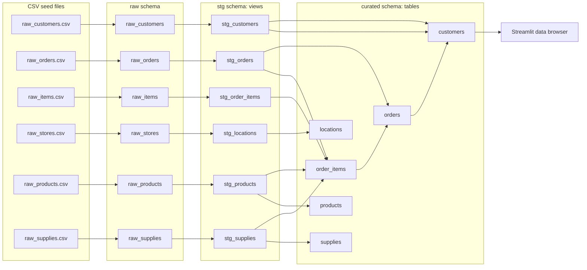

# project-platform-dbt-databricks
> This project uses the dbt Jaffle Shop sample data as a practical example for building and operating a data platform on Databricks Free Edition. Its focus is on platform engineering best practices—including infrastructure and workload management, secure service-principal authentication, source control, CI/CD, automated testing, and release management—with dbt. Additionally, a small Streamlit app per environment is created for exploring the curated models serving as example workloads on the platform.

The project explores:

- dbt development and deployment on Databricks
- Databricks Asset Bundles for infrastructure and workload management (job & streamlit app)
- Source control and deployment best practices
- Pull request based development workflow
- Automated release management with Release Please
- CI/CD automation using GitHub Actions
- Automated testing and deployment across environments
- Service Principal authentication instead of personal credentials (per environment: one sp deployer & one sp job runner)

## 🧪 Technologies
- Python 3.12
- Azure Databricks Serverless
- Unity Catalog
- Databricks Asset Bundles
- Lakeflow Jobs
- dbt Core 1.12.5
- Visual Studio Code (GitHub Codespace)
- Pre-commit
- Commitizen
- uv
- ruff
- sqlfmt
- SQLFluff
- Just
- GitHub Actions
- Dependabot

## 📦 Features
### Analytics Engineering
- dbt Core project based on the Jaffle Shop dataset
- Layered transformation approach (raw, staging, marts)
- Automated data quality testing
- Documentation generation

### Platform & Deployment
- Databricks Asset Bundles (DAB)
- Environment-specific deployments (Dev, Test, Prod)
- A small Streamlit app deployed in each environment as a proof of concept for exploring the curated models
- Service Principal authentication
- Databricks Workflows orchestration

### DevOps
- GitHub Actions CI/CD pipelines
- Pull request validation checks
- Automated deployment promotion
- Release Please automated versioning and changelog management
- Git-based development workflow

## Repository Structure

- `.github/` — GitHub Actions workflows and repository automation
- `resources/` — Databricks Asset Bundle definitions for the dbt job and Streamlit app
- `src/` — dbt project, including models, tests, seeds, and macros
- `streamlit/` — Streamlit data browser application
- `databricks.yml` — Bundle targets and environment-specific settings
- `.dbt/` — Local dbt connection profiles
- `justfile`, `pyproject.toml`, and `uv.lock` — Common development commands and Python dependencies

## Databricks Platform Structure

Each deployed environment has its own Unity Catalog catalog. The dbt job uses the `default` schema as its target schema; the dbt project writes seeds, staging models, and marts to `raw`, `stg`, and `curated` respectively.

| Environment | Catalog | Schemas | Deployer service principal | Job runner service principal |
| --- | --- | --- | --- | --- |
| `dev` | `dev_dbt` | `default`, `raw`, `stg`, `curated` | `dev_dbt_deployer_sp` (`DATABRICKS_CLIENT_ID` secret) | `dev_dbt_sp` (`DATABRICKS_CLIENT_ID_JOB` secret) |
| `tst` | `tst_dbt` | `default`, `raw`, `stg`, `curated` | `tst_dbt_deployer_sp` (`DATABRICKS_CLIENT_ID` secret) | `tst_dbt_sp` (`DATABRICKS_CLIENT_ID_JOB` secret) |
| `prd` | `prd_dbt` | `default`, `raw`, `stg`, `curated` | `prd_dbt_deployer_sp` (`DATABRICKS_CLIENT_ID` secret) | `prd_dbt_sp` (`DATABRICKS_CLIENT_ID_JOB` secret) |

The service principal client IDs are configured as secrets in each corresponding GitHub Actions environment; their values are not stored in the repository. The production dbt documentation workflow uses the separate `sp-dbt-docs-publisher-prd` service principal.

## Deployment Lifecycle

| Stage | Trigger | Automated actions |
| --- | --- | --- |
| Pull request | Opened or updated against `main` | CI runs PR checks; deployments do not run from the pull request. |
| Development (`dev`) | A commit is merged to `main` and Release Please does not create a release | GitHub Actions validates and deploys the merged commit to the `dev` Databricks workspace, then starts the Streamlit app. |
| Test (`tst`) | Release Please creates a release/tag from `main` | GitHub Actions validates and deploys the tagged release to `tst`, then starts the Streamlit app. |
| Production (`prd`) | An operator manually runs **Deploy release to prd** and supplies a release tag | GitHub Actions validates and deploys that tag to `prd`, then starts the Streamlit app. After a successful deployment, it generates and publishes dbt documentation for the same release tag. |

Production deployment is the manual promotion step; development and test deployments are automated. A release event deploys to `tst` rather than `dev`.

## Data Flow

The Databricks job runs `dbt seed` followed by `dbt build`. This flow applies to the `dev_dbt`, `tst_dbt`, and `prd_dbt` catalogs.

## Getting Started
### What you need

#### Local development

- Python 3.12
- [uv](https://docs.astral.sh/uv/) for Python and project dependency management
- Git
- [Databricks CLI](https://github.com/databricks/cli)
- [Just](https://github.com/casey/just), installable with `uv tool install rust-just`
- A Databricks workspace with Unity Catalog access and a SQL warehouse

#### GitHub Actions deployments

Configure the following in each GitHub Actions environment (`dev`, `tst`, and `prd`):

- **Environment variable** `DATABRICKS_HOST`: the workspace URL
- **Environment variable** `BUNDLE_VAR_WAREHOUSE_NAME`: the SQL warehouse name
- **Secret** `DATABRICKS_CLIENT_ID`: the deployer service principal's application/client ID
- **Secret** `DATABRICKS_CLIENT_SECRET`: the deployer service principal's OAuth secret
- **Secret** `DATABRICKS_CLIENT_ID_JOB`: the job runner service principal's application/client ID

The deployer service principal needs permission to deploy the bundle and manage the deployed resources. The job runner service principal needs permission to run the dbt job and access the target catalog, schemas, and warehouse. Set up the required service principals and workspace permissions in Databricks; do not store their credentials in the repository.

#### GitHub Pages dbt documentation

View the published documentation: [dbt documentation](https://dede0610.github.io/project-platform-dbt-databricks/).

To publish dbt documentation, set the repository's Pages source to **GitHub Actions** and add `DATABRICKS_DOCS_CLIENT_ID` and `DATABRICKS_DOCS_CLIENT_SECRET` as repository Actions secrets for `sp-dbt-docs-publisher-prd`. Grant this service principal `BROWSE`, `READ METADATA`, and `USE CATALOG` on the `prd_dbt` catalog, and `USE SCHEMA` on the `prd_dbt` schema. It also needs access to the SQL warehouse so the workflow can generate catalog metadata. GitHub Pages is redeployed after a release is successfully deployed to production. The docs workflow checks out that release's tag, so the published documentation for business users stays aligned with the code and data model deployed to `prd`. It can also be run manually for a selected release version.

The generated site includes model and column metadata and is publicly accessible when repository Pages visibility is public. Review the generated documentation for sensitive information before enabling publication.
